<p align="center">
  <a href="https://alibi.fit"></a>&nbsp;
  <a href="https://www.linkedin.com/in/neeraj-pratap-singh/"></a>&nbsp;
  <a href="mailto:pratapneeraj240@gmail.com"></a>
</p>

<p align="center">
  I build products end to end, from the database schema and backend to the app people actually open.<br/>
  CS grad · data + product · currently shipping my first app to the Play Store.
</p>

<br/>

## 🔥 Now building: [Alibi](https://alibi.fit)

> **Your squad sees if you skip.** Gym check-ins with proof, shared streaks and friends who keep you honest.

Pick your look: two complete UIs, each with its own colour themes.

<p align="center"><b>🎮 Playful</b></p>
<p align="center">
  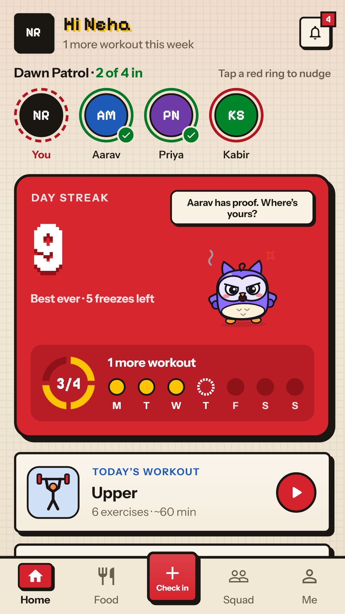
  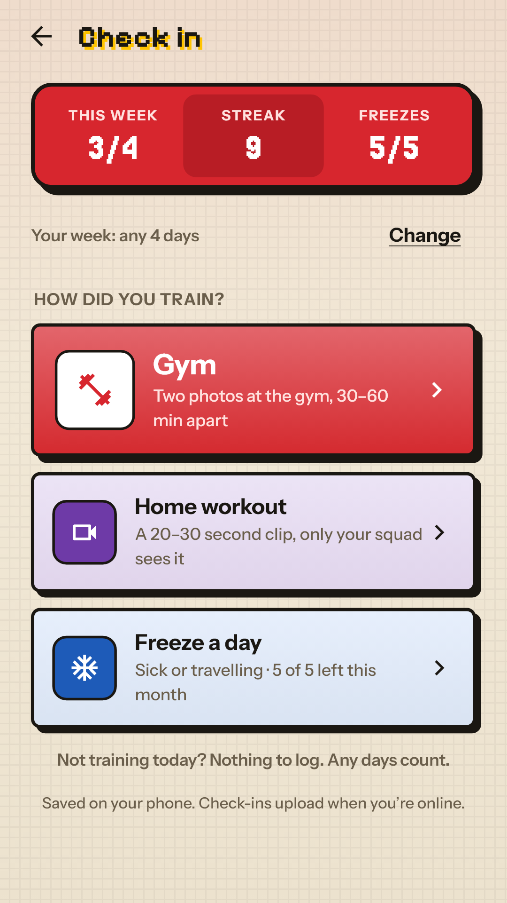
  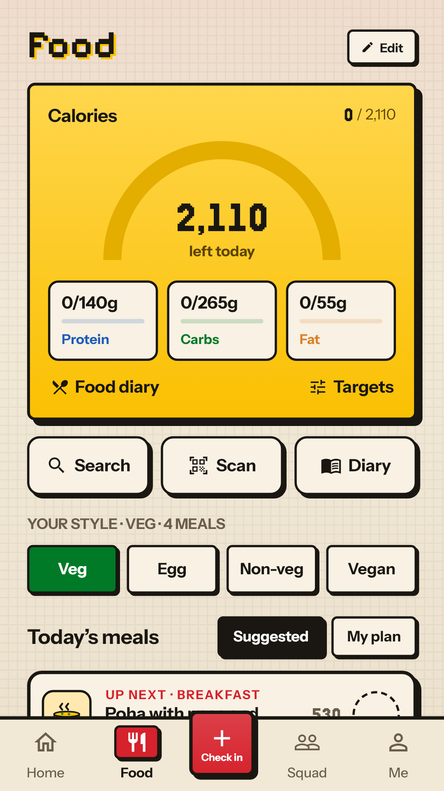
  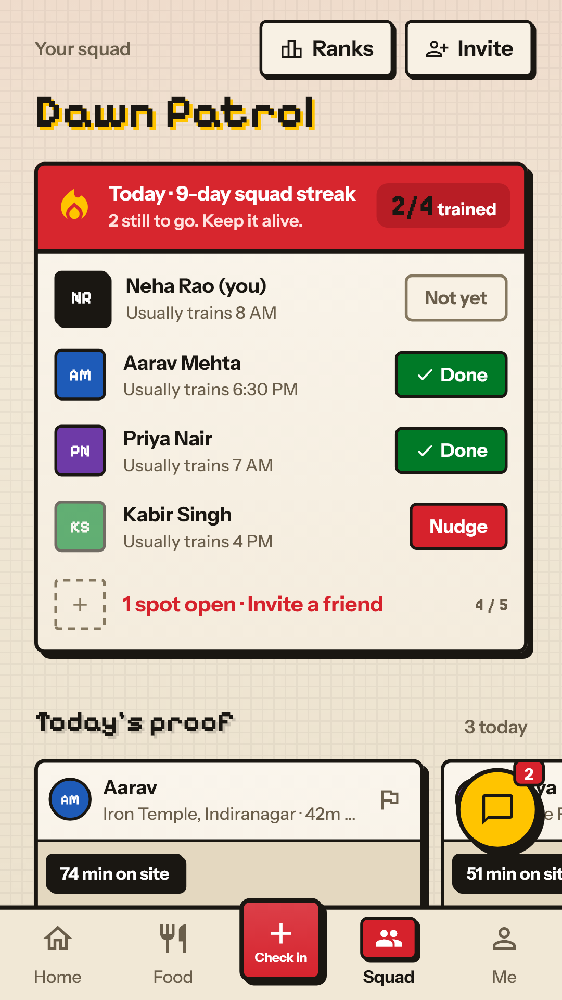
</p>

<p align="center"><b>✨ Simple</b></p>
<p align="center">
  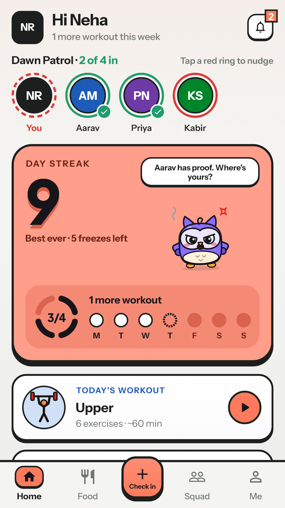
  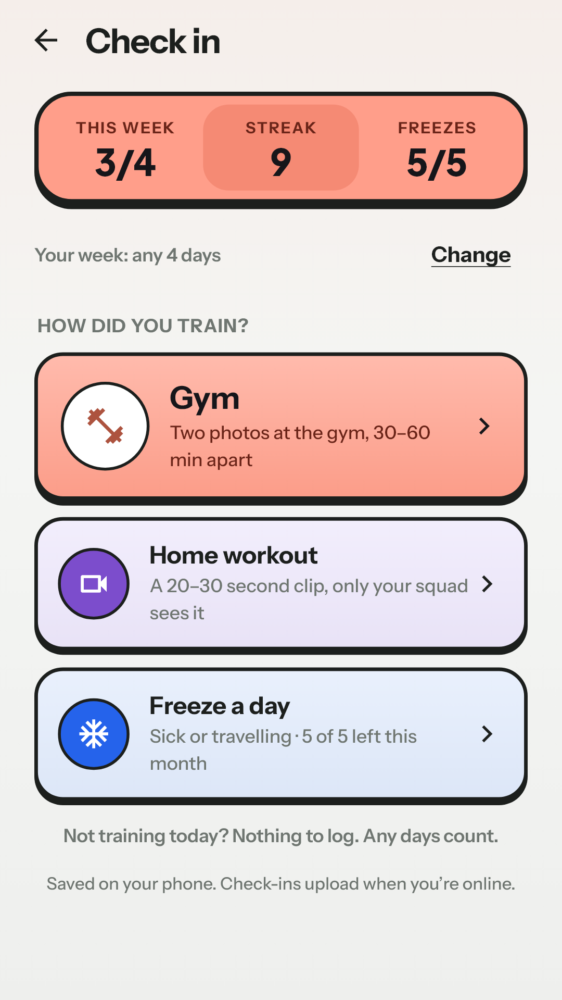
  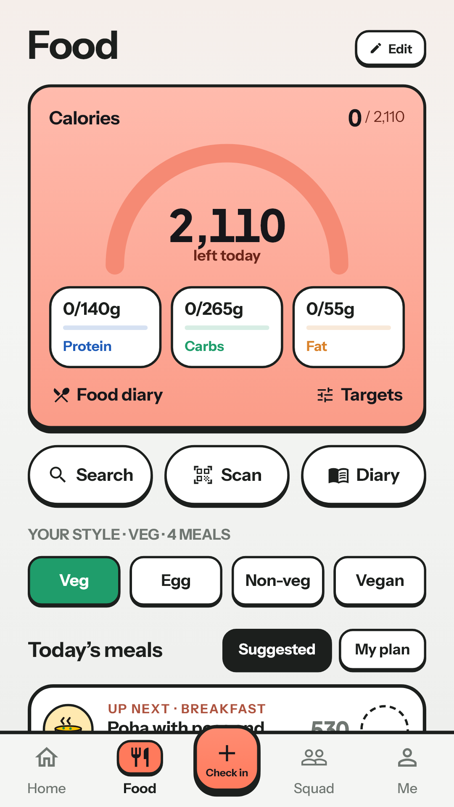
  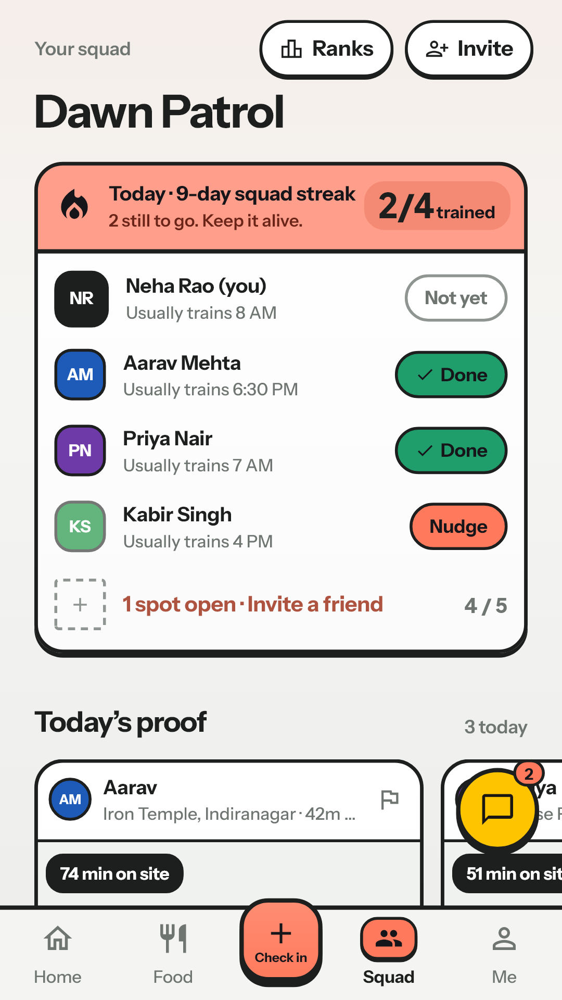
</p>

<table>
<tr>
<td width="50%" valign="top">

**What it does**

- 📸 **Verified check-ins:** selfie with on-device face detection, plus a GPS gym geofence
- 👥 **Squads:** shared streaks, chat, proof photos, QR invites and push nudges
- 🍽️ **Food diary:** barcode scanning and a daily calorie target
- 🦉 **Mascots:** pick Kettl, Hoot or Gummy, who grows from baby to hero and roasts you when you skip

</td>
<td width="50%" valign="top">

**How it's built**

- **App:** Flutter, Riverpod, go_router
- **Backend:** Supabase (Postgres, row-level security, 40+ migrations, edge functions)
- **Push:** Firebase Cloud Messaging
- **On-device ML:** Google ML Kit face detection
- **Auth:** Google Sign-In

[**alibi.fit ↗**](https://alibi.fit) · [**PRD + live web demo ↗**](https://neerajpratapsingh.github.io/alibi/)

</td>
</tr>
</table>

<br/>

## 🧩 Other things I've built

<table>
<tr>
<td width="50%" valign="top">

### [📁 Splash](https://github.com/NeerajPratapSingh/Splash)

A fast, lightweight file explorer for Windows with tabs, split view, photo previews, archives and instant whole-PC search.

<a href="https://github.com/NeerajPratapSingh/Splash"></a>

`Rust` `Tauri 2` `React` `TypeScript` · [**Download ↗**](https://github.com/NeerajPratapSingh/Splash/releases/latest)

</td>
<td width="50%" valign="top">

### [🧠 YouDumb](https://youdumb.netlify.app)

AI got smarter every year. Did you? A free brain game where you climb from a 1966 chatbot to today's frontier models across logic, math, aptitude, business and code, and learn the trick behind every question.

<a href="https://youdumb.netlify.app">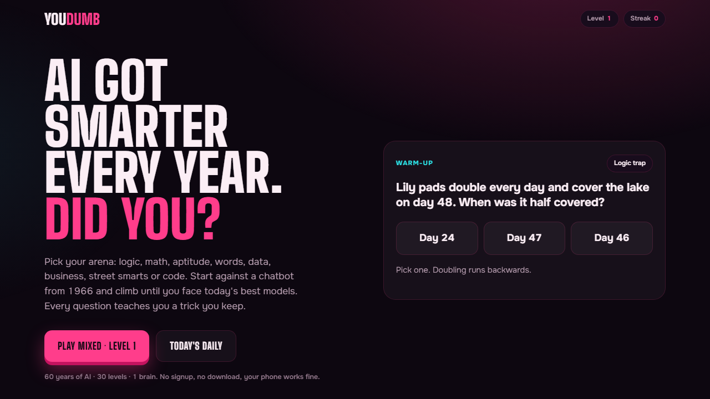</a>

`HTML` `JavaScript` `Supabase` `Netlify` · [**Play it ↗**](https://youdumb.netlify.app)

</td>
</tr>
<tr>
<td width="50%" valign="top">

### [🚗 Repo Road Trip](https://github.com/NeerajPratapSingh/repo-road-trip)

Drive through any GitHub profile in a lofi town. Every repo is a shop you can pull up to and chat with, and the answers come from that repo's real README.

`JavaScript` `KAPLAY` `GitHub API` `Gemini` `Vercel` · [**Play it ↗**](https://repo-road-trip.vercel.app)

</td>
<td width="50%" valign="top">

### [📊 Claude Usage Tracker](https://github.com/NeerajPratapSingh/Claude_Usage_Tracker)

A Claude Code mod that shows your 5-hour and weekly limits as live bars, alerts at 75/90/100%, and breaks down tokens and cost per model.

`TypeScript` `Claude Code plugin`

</td>
</tr>
</table>

<details>
<summary><b>🗂️ Earlier projects</b></summary>
<br/>

| Project | What it is | Built with |
|---|---|---|
| **[Aneurysm Detection](https://github.com/NeerajPratapSingh/Aneurysm-Detection)** | Deep learning pipeline that detects intracranial aneurysms in CTA, MRA and MRI scans | Python · Deep Learning |
| **[GDM Early Prediction](https://github.com/NeerajPratapSingh/Gestational-Diabetes)** | Predicts gestational diabetes risk early in pregnancy from clinical data | Python · Jupyter |
| **[Smart Home Automation](https://github.com/NeerajPratapSingh/Smart-Home-Automation)** | Arduino controller for four appliances over Bluetooth or an IR remote | C++ · Arduino |

</details>

<br/>

## 📄 Research

<table>
<tr>
<td width="50%" valign="top">

### Video Based Analysis of Exercise Form for Performance Assessment and Injury Prevention

**Published** · ICSIT 2025, IEEE Xplore<br/>
S.S. Saranya, Ahhsanul Hoque, **Neeraj Pratap**

Classifies exercise posture from video with ensemble ML models to catch form errors and recommend personalised workouts, for fitness and rehab.

[**Read on IEEE Xplore ↗**](https://ieeexplore.ieee.org/document/11295195) · DOI [10.1109/ICSIT65336.2025.11295195](https://doi.org/10.1109/ICSIT65336.2025.11295195)

</td>
<td width="50%" valign="top">

### AneurysmNet: Multi-Frame Aneurysm Detection Using EfficientNetV2 and Modality-Aware Preprocessing

**Presented** · BIDA 2026, RV Institute of Management, Bengaluru · to appear in Springer proceedings<br/>
S.S. Saranya, Ahhsanul Hoque, **Neeraj Pratap**

Detects intracranial aneurysms across CTA, MRA and MRI scans with EfficientNetV2 and preprocessing tuned to each scan type. [Code ↗](https://github.com/NeerajPratapSingh/Aneurysm-Detection)

<a href="assets/certs/bida2026-presentation.png">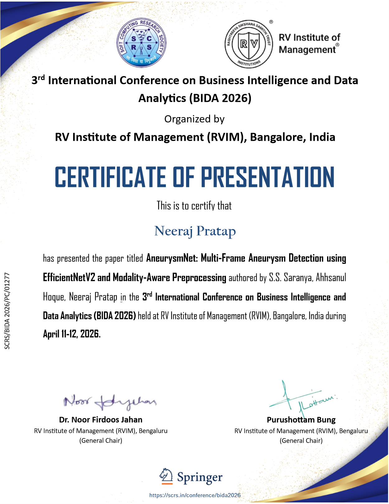</a>

</td>
</tr>
</table>

<table>
<tr>
<td width="200"><a href="assets/certs/chancellors-award.jpg">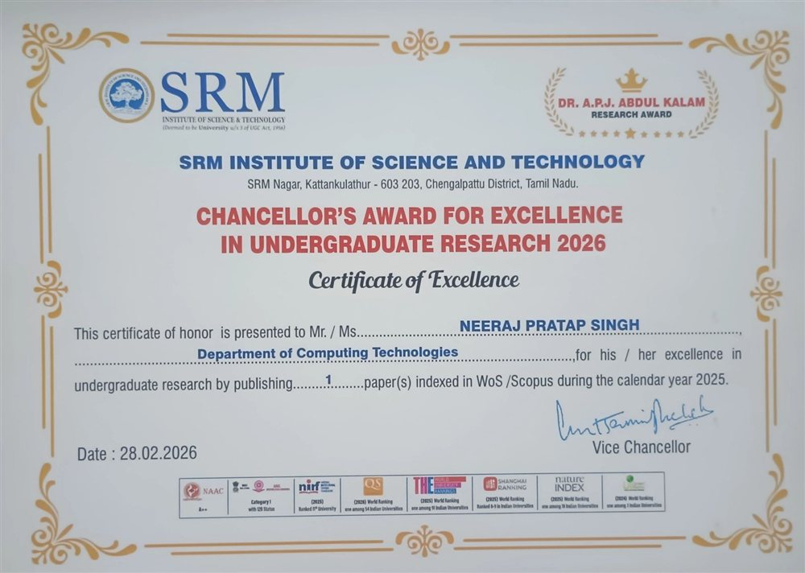</a></td>
<td>🏆 <b>Chancellor's Award for Excellence in Undergraduate Research 2026</b><br/>SRM Institute of Science and Technology, for publishing research indexed in WoS/Scopus in 2025.</td>
</tr>
</table>

## 🏅 Certifications

<table>
<tr>
<td width="50%" align="center"><a href="assets/certs/oci-genai.png">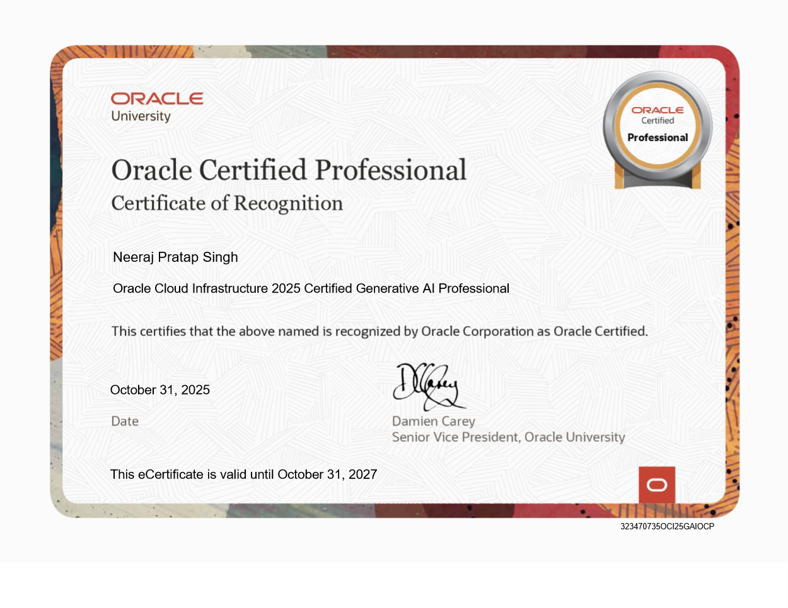</a><br/><b>OCI 2025 Generative AI Professional</b><br/><sub>Oracle · Oct 2025</sub></td>
<td width="50%" align="center"><a href="assets/certs/oci-datascience.png"></a><br/><b>OCI 2025 Data Science Professional</b><br/><sub>Oracle · Nov 2025</sub></td>
</tr>
<tr>
<td width="50%" align="center"><a href="assets/certs/servicenow-cad.png">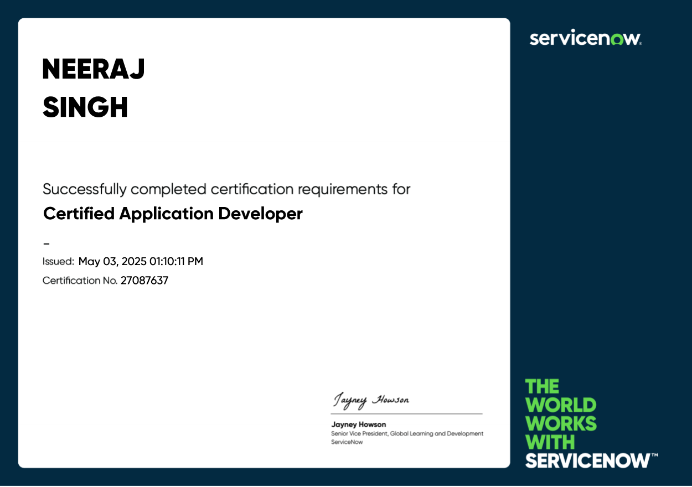</a><br/><b>Certified Application Developer</b><br/><sub>ServiceNow · May 2025</sub></td>
<td width="50%" align="center"><a href="assets/certs/servicenow-csa.png"></a><br/><b>Certified System Administrator</b><br/><sub>ServiceNow · Nov 2024</sub></td>
</tr>
</table>

## 🛠️ Toolbox

<table>
<tr><td width="150"><b>📱&nbsp;App</b></td><td align="center" width="88"><br/><sub>Flutter</sub></td><td align="center" width="88"><br/><sub>Dart</sub></td><td align="center" width="88"><br/><sub>Firebase</sub></td></tr>
<tr><td width="150"><b>🗄️&nbsp;Backend</b></td><td align="center" width="88"><br/><sub>Supabase</sub></td><td align="center" width="88"><br/><sub>PostgreSQL</sub></td><td align="center" width="88"><br/><sub>Vercel</sub></td><td align="center" width="88"><br/><sub>Netlify</sub></td><td align="center" width="88"><br/><sub>Actions</sub></td></tr>
<tr><td width="150"><b>🖥️&nbsp;Web&nbsp;&&nbsp;desktop</b></td><td align="center" width="88"><br/><sub>TypeScript</sub></td><td align="center" width="88"><br/><sub>JavaScript</sub></td><td align="center" width="88"><br/><sub>React</sub></td><td align="center" width="88"><br/><sub>Vite</sub></td><td align="center" width="88"><br/><sub>Rust</sub></td><td align="center" width="88"><br/><sub>Tauri</sub></td><td align="center" width="88"><br/><sub>HTML</sub></td><td align="center" width="88"><br/><sub>CSS</sub></td></tr>
<tr><td width="150"><b>🧠&nbsp;Data&nbsp;&&nbsp;ML</b></td><td align="center" width="88"><br/><sub>Python</sub></td><td align="center" width="88"><br/><sub>TensorFlow</sub></td><td align="center" width="88"><br/><sub>scikit-learn</sub></td></tr>
<tr><td width="150"><b>🔌&nbsp;Hardware&nbsp;&&nbsp;tools</b></td><td align="center" width="88"><br/><sub>C++</sub></td><td align="center" width="88"><br/><sub>Arduino</sub></td><td align="center" width="88"><br/><sub>Git</sub></td><td align="center" width="88"><br/><sub>VS Code</sub></td></tr>
</table>

## 🙋 About me

I like owning the whole thing: figuring out the problem, writing the PRD, designing the screens, shaping the database and shipping the app. Right now that's **Alibi**, which I'm building solo from Bengaluru.

```ts
const neeraj = {
  basedIn:    "Bengaluru, India",
  studied:    "B.Tech CSE @ SRM Institute of Science and Technology",
  building:   "Alibi: gym accountability for squads",
  dayJob:     "performance + funnel dashboards teams decide on",
  award:      "SRM Chancellor's Award for undergraduate research, 2026",
  certified:  ["OCI Gen AI", "OCI Data Science", "ServiceNow CAD + CSA"],
  askMeAbout: ["Flutter + Supabase", "writing PRDs", "ML on health data"],
  funFact:    "I built an app that roasts me when I skip the gym",
};
```

> 🚀 **Right now:** getting Alibi onto the Play Store. Want to be an early tester? [Drop me an email.](mailto:pratapneeraj240@gmail.com)

## 🐍 Eating my commits

<picture>
  <source media="(prefers-color-scheme: dark)" srcset="https://raw.githubusercontent.com/NeerajPratapSingh/NeerajPratapSingh/output/snake-dark.svg"/>
  <source media="(prefers-color-scheme: light)" srcset="https://raw.githubusercontent.com/NeerajPratapSingh/NeerajPratapSingh/output/snake.svg"/>
  
</picture>

<br/>

<p align="center">
  
</p>
